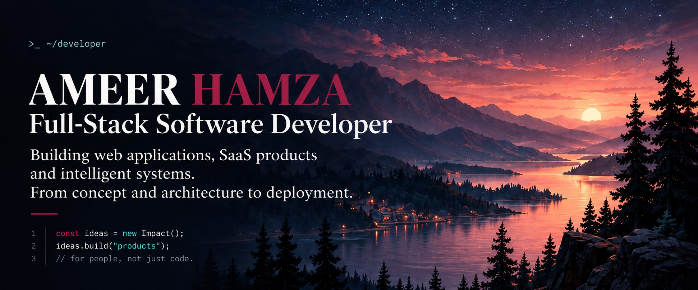
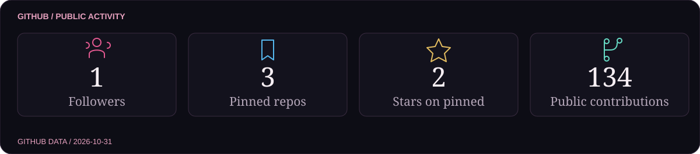
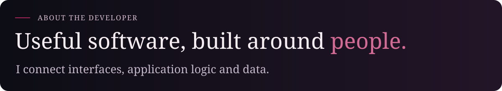
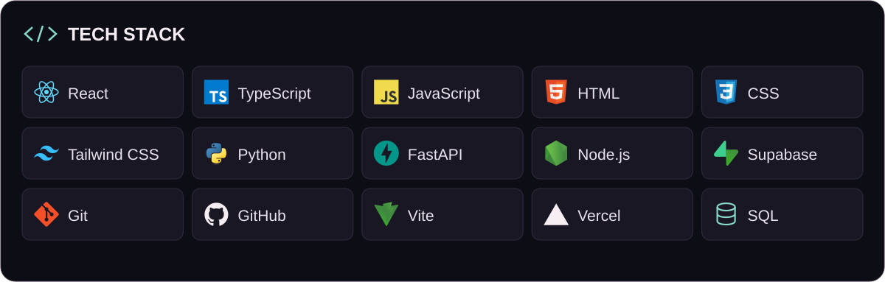
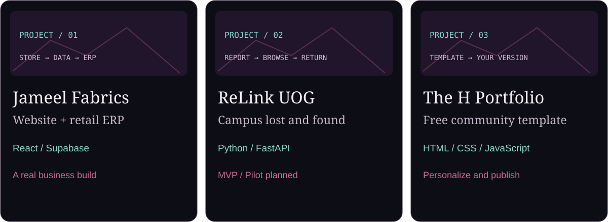
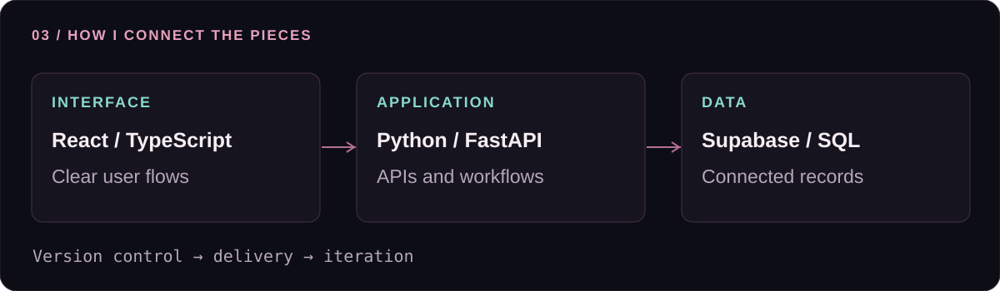

<picture>
  <source media="(max-width: 640px)" srcset="assets/hero-mobile-cinematic.jpg">
  
</picture>

  
  
  
  

<picture>
  <source media="(max-width: 640px)" srcset="assets/stats-mobile-cinematic.svg">
  
</picture>

I’m **Ameer Hamza**, a software developer building web applications, SaaS products and intelligent systems. I work across **React, Supabase and Python**, connecting interfaces, application logic and databases from concept to deployment.

My work includes a family-business retail system, an independent campus lost-and-found MVP and a free portfolio starter for other developers.

<picture>
  <source media="(max-width: 640px)" srcset="assets/tech-stack-mobile.svg">
  
</picture>

### Selected work

<picture>
  <source media="(max-width: 640px)" srcset="assets/projects-mobile-cinematic.svg">
  
</picture>

**Jameel Fabrics** · Customer website and retail ERP sharing a Supabase database, with an admin panel, themes, PWA support and WhatsApp bills.

[Customer website](https://jameel-fabrics-catalogue.vercel.app) · [Retail system](https://jameel-fabrics-kunjah-phis.vercel.app) · [Website source](https://github.com/Hamza-Muhammadi/Jameel-Fabrics-Online-Website) · [ERP source](https://github.com/Hamza-Muhammadi/Jameel-Fabrics-Kunjah)

**ReLink UOG** · Independent MVP for lost/found reports, browsing, authentication and a personal dashboard. Built for a planned campus pilot.

[Project overview](https://hamza-muhammadi.github.io/Ameer-Hamza-Portfolio/#originals)

**The H Portfolio** · Responsive community template with a browser customizer, AI master prompt and beginner-friendly publishing guide.

[Get the starter kit](https://hamza-muhammadi.github.io/The-H-Portfolio-Template/start/) · [Live template](https://hamza-muhammadi.github.io/The-H-Portfolio-Template/) · [Source code](https://github.com/Hamza-Muhammadi/The-H-Portfolio-Template)

### Technical toolkit

- **Interfaces:** React · TypeScript · JavaScript · HTML · CSS · Tailwind CSS
- **Applications & data:** Python · FastAPI · Node.js · Supabase · SQL · API integration
- **Motion & delivery:** Framer Motion · Vite · Git · GitHub · Vercel · GitHub Pages
- **Product focus:** Business websites · Retail tools · SaaS interfaces · Workflow automation

### Background & community

**BS Software Engineering · University of Gujrat**

Alongside development, I contribute to the Software Engineering Evening Society as an Executive Member and the Business Incubation Center as an Outreach Member.

### Public contribution activity

Generated from GitHub data. Daily refresh; each image shows its snapshot date. This dashboard covers public activity. Your signed-in native graph may also include private contributions.

  <a href="https://hamza-muhammadi.github.io/Ameer-Hamza-Portfolio/">Portfolio</a> &nbsp; · &nbsp;
  <a href="https://www.linkedin.com/in/ameer-hamza-muhammadi">LinkedIn</a> &nbsp; · &nbsp;
  <a href="mailto:ameerhamzamuhammadi.056@gmail.com">Email</a>

