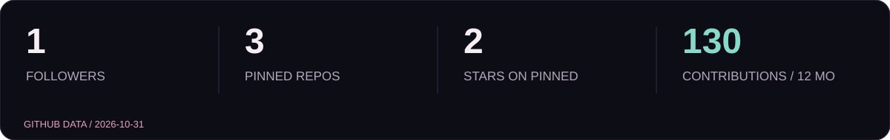
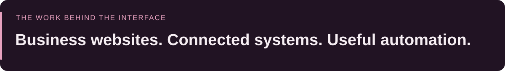
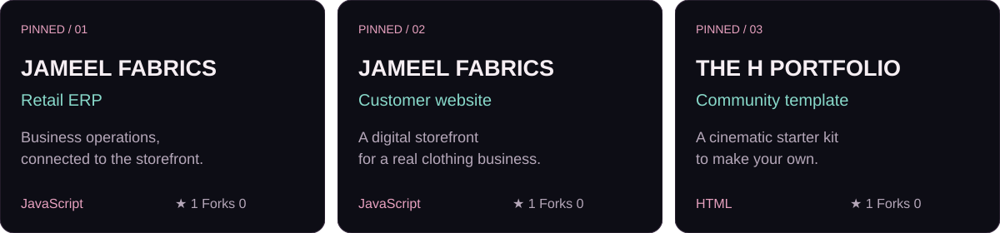
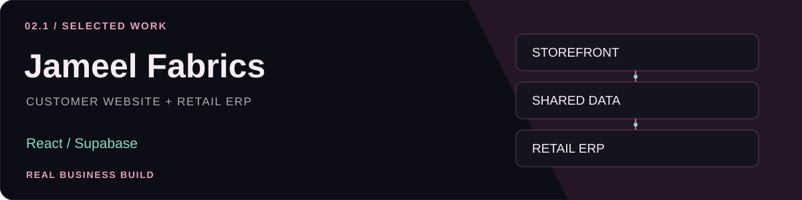
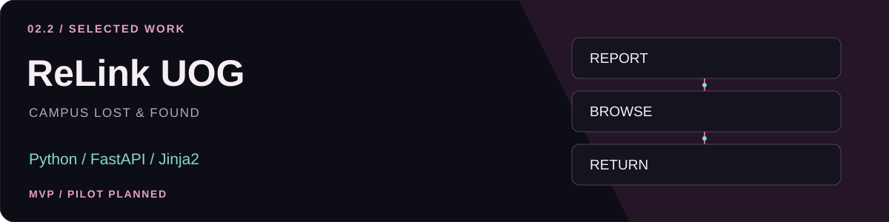
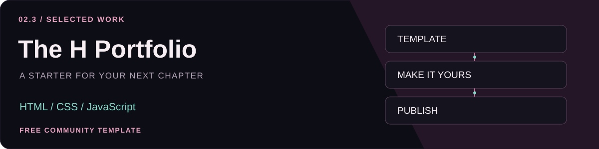
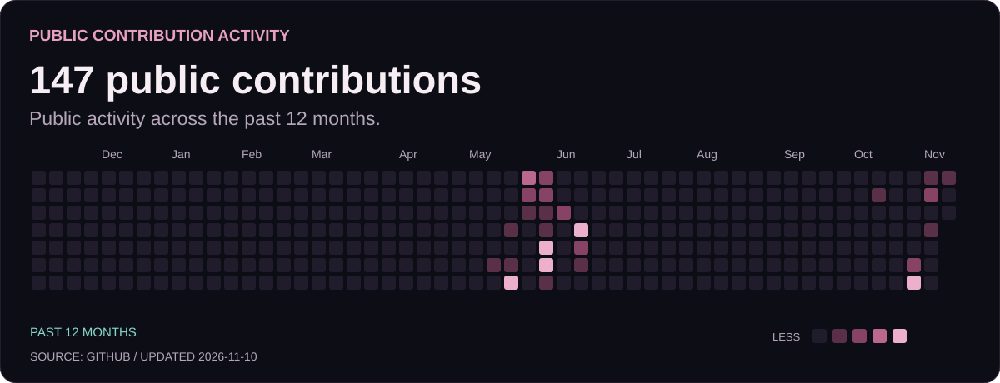
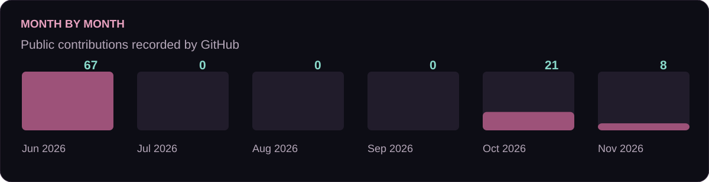

<picture>
  <source media="(max-width: 640px)" srcset="assets/hero-mobile-v3.svg">
  
</picture>

  
  
  
  

<picture>
  <source media="(max-width: 640px)" srcset="assets/stats-mobile-v3.svg">
  
</picture>

**I build full-stack applications around the way people actually work.** My projects connect customer-facing websites, internal business tools and shared data, with clear interfaces and practical automation.

From a retail system for a family business to an independent campus lost-and-found platform, I work across the interface, application logic and database to turn an idea into something people can use.

### Pinned repositories

<picture>
  <source media="(max-width: 640px)" srcset="assets/pins-mobile-v3.svg">
  
</picture>

[Retail ERP](https://github.com/Hamza-Muhammadi/Jameel-Fabrics-Kunjah) · [Customer website](https://github.com/Hamza-Muhammadi/Jameel-Fabrics-Online-Website) · [Portfolio starter](https://github.com/Hamza-Muhammadi/The-H-Portfolio-Template)

### Selected work

**One business, two connected experiences.** Built a customer website and an internal retail system around a shared Supabase database. Features include an admin panel, theme options, PWA support and WhatsApp bill generation.

[Customer website ↗](https://jameel-fabrics-catalogue.vercel.app) · [Retail system ↗](https://jameel-fabrics-kunjah-phis.vercel.app) · [Website source](https://github.com/Hamza-Muhammadi/Jameel-Fabrics-Online-Website) · [ERP source](https://github.com/Hamza-Muhammadi/Jameel-Fabrics-Kunjah)

**A clearer way to report and find lost items on campus.** Independently developed an MVP with lost/found reports, item browsing, registration, login and a personal dashboard. Built independently for a planned campus pilot.

[Project overview ↗](https://hamza-muhammadi.github.io/Ameer-Hamza-Portfolio/#originals)

**Help other developers give their work a home.** Created a cinematic portfolio template with responsive sections, a browser customizer and a beginner-friendly resource page. The AI master prompt guides users through personalization, demo review and publishing their own copy.

[Get the starter kit ↗](https://hamza-muhammadi.github.io/The-H-Portfolio-Template/start/) · [Explore the template ↗](https://hamza-muhammadi.github.io/The-H-Portfolio-Template/) · [Source code](https://github.com/Hamza-Muhammadi/The-H-Portfolio-Template)

### Technical toolkit

- **Interfaces:** React · TypeScript · JavaScript · HTML · CSS · Tailwind CSS
- **Applications & data:** Python · FastAPI · Node.js · Supabase · SQL · API integration
- **Motion & delivery:** Framer Motion · Vite · Git · GitHub · Vercel · GitHub Pages
- **Product focus:** Business websites · Retail tools · SaaS interfaces · Workflow automation

### Background & community

**BS Software Engineering · University of Gujrat**

Alongside development, I contribute to the Software Engineering Evening Society as an Executive Member and the Business Incubation Center as an Outreach Member.

### Contribution activity

Generated from GitHub data. Daily refresh; each image shows its snapshot date. GitHub’s native graph below remains the current source for activity.

  <a href="https://hamza-muhammadi.github.io/Ameer-Hamza-Portfolio/">Portfolio</a> &nbsp; · &nbsp;
  <a href="https://www.linkedin.com/in/ameer-hamza-muhammadi">LinkedIn</a> &nbsp; · &nbsp;
  <a href="mailto:ameerhamzamuhammadi.056@gmail.com">Email</a>

