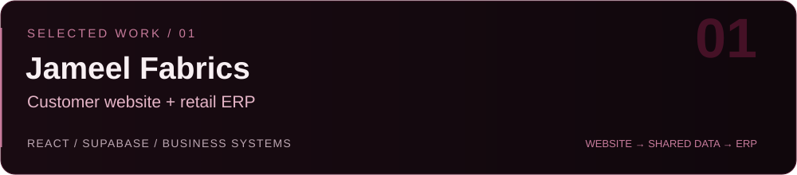
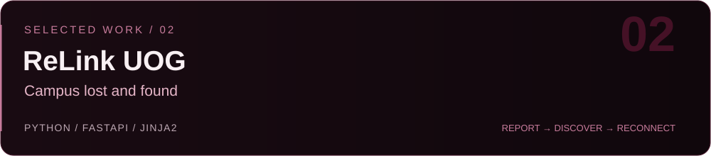
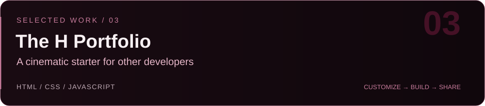

  <a href="https://hamza-muhammadi.github.io/Ameer-Hamza-Portfolio/"><b>Portfolio ↗</b></a> &nbsp; · &nbsp;
  <a href="https://www.linkedin.com/in/ameer-hamza-muhammadi"><b>LinkedIn ↗</b></a> &nbsp; · &nbsp;
  <a href="mailto:ameerhamzamuhammadi.056@gmail.com"><b>Email ↗</b></a>

I’m **Ameer Hamza**, a software developer and BS Software Engineering student at the **University of Gujrat**. I build customer websites, internal business tools and connected workflows, with a focus on making the day-to-day work behind a product simpler.

My work spans React interfaces, Supabase-backed applications and Python APIs. I care about clear user flows, useful features and layouts that work on a phone.

### Selected work

A customer-facing clothing website and internal retail system for a real family business, connected through a shared Supabase database. Includes an admin panel, theme options, PWA support and WhatsApp bill generation.

[Customer website ↗](https://jameel-fabrics-catalogue.vercel.app) · [ERP ↗](https://jameel-fabrics-kunjah-phis.vercel.app) · [Website code](https://github.com/Hamza-Muhammadi/Jameel-Fabrics-Online-Website) · [ERP code](https://github.com/Hamza-Muhammadi/Jameel-Fabrics-Kunjah)

An independent lost-and-found platform for the UOG community. The MVP supports lost/found reports, item browsing, accounts and a personal dashboard. Built for a future campus pilot.

[Project overview in my portfolio ↗](https://hamza-muhammadi.github.io/Ameer-Hamza-Portfolio/#originals)

A free portfolio starter with a cinematic intro, responsive sections and a browser-based customizer. Includes a setup guide and master prompt so other developers can make their own version.

[Live template ↗](https://hamza-muhammadi.github.io/The-H-Portfolio-Template/) · [Use the template](https://github.com/Hamza-Muhammadi/The-H-Portfolio-Template)

### Technical toolkit

| Area | Tools I use |
| :--- | :--- |
| Interfaces | React, TypeScript, JavaScript, HTML, CSS, Tailwind CSS |
| Backend & data | Python, FastAPI, Node.js, Supabase, SQL |
| Motion & delivery | Framer Motion, Vite, Git, GitHub, Vercel, GitHub Pages |
| Product work | Business websites, retail tools, API integration, workflow automation |

### Beyond the code

Software Engineering student at the **University of Gujrat**. My campus involvement includes the Software Engineering Evening Society and Business Incubation Center outreach.

### Development activity

My genuine contribution history is available in the **GitHub contribution graph below**. Browse [my public repositories](https://github.com/Hamza-Muhammadi?tab=repositories) for the code I can share; some business and campus projects remain private.

